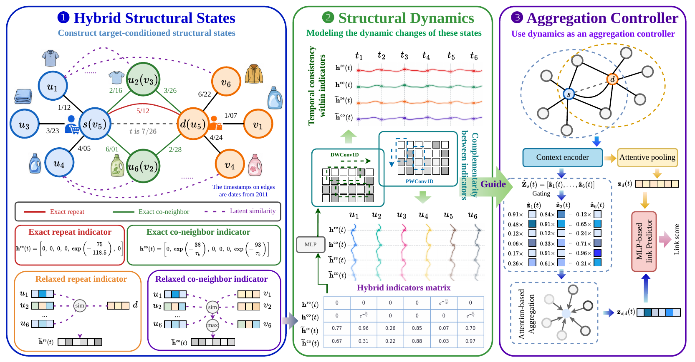

<h1 align="center">A New Perspective on Target-Conditioned Structural Dynamics<br>for Link Prediction in Dynamic Graphs</h1>

<p align="center">
  
  
  
  
</p>

<p align="center">
  <a href="#overview">Overview</a> ·
  <a href="#results">Results</a> ·
  <a href="#getting-started">Getting started</a> ·
  <a href="#training-and-evaluation">Training</a> ·
  <a href="#using-your-own-dataset">Your own dataset</a> ·
  <a href="#citation">Citation</a>
</p>

This repository is the official implementation of **TCSD**. The baselines stay available next to TCSD and all methods share the same data splits, negative sampling and metrics.

## Overview

TCSD treats structural signals as **states that evolve over the recent history**, and lets their dynamics control the aggregation.

<p align="center">
  
</p>

| Step | What it does | Paper | Code |
|---|---|---|---|
| **1. Hybrid structural states** | Exact indicators keep time-aware repeat and co-neighbor matches, relaxed indicators recover latent support through embedding similarity | Eq. 1-4 | `exact_repeat`, `exact_co_neighbor`, `relaxed_repeat`, `relaxed_co_neighbor` |
| **2. Structural dynamics** | Depthwise and pointwise convolutions capture temporal consistency within an indicator and complementarity across indicators | Eq. 6 | `StructuralDynamicsEncoder` |
| **3. Dynamics-guided aggregation** | A dimension-wise gate and attentive pooling amplify target-relevant neighbors and suppress irrelevant ones | Eq. 7-8 | `StructuralDynamicsEncoder.gate_mlp`, `TCSD.attentive_pool` |

[`models/TCSD.py`](models/TCSD.py) holds the core of the method, and the general layers it uses are in [`models/modules.py`](models/modules.py). Like the other models of this codebase, `TCSD` computes the source and destination embeddings and a merge layer, here `ProductMergeLayer`, scores them. As the source embedding depends on the candidate, `compute_src_dst_node_temporal_embeddings` takes all the candidates of a query at once.

## Results

- **Best on 13 of 16 datasets** against ten baselines
- **Up to +14.27%** relative MRR improvement, on YouTube
- **4.43× faster per epoch** than DyGFormer on mooc, and 3.76× on lastfm
- 

## Getting started

### Installation

Python 3.9 and PyTorch 2.0.0 were used. Install a CUDA build of PyTorch first, then:

```bash
git clone https://github.com/LuckyGirl-XU/TCSD.git
cd TCSD
conda create -n tcsd python=3.9
conda activate tcsd
pip install -r requirements.txt
```

### Data preparation

`uci` is included in [`data/uci/`](data/uci), so the quick start runs without any download. Place the other datasets under `./data/`, or pass another folder with `--dataset_path`. Each dataset is split chronologically into 70% training, 15% validation and 15% test.

| Datasets | Where to get them | Files read by the code |
|---|---|---|
| `wikipedia`, `reddit`, `mooc`, `lastfm`, `uci`, `Flights` | Download the original files from [Zenodo](https://zenodo.org/record/7213796) and process them with `preprocess_data/preprocess_data.py` of [DyGLib](https://github.com/yule-BUAA/DyGLib) | `data/<name>/ml_<name>.csv`, `ml_<name>.npy`, `ml_<name>_node.npy` |
| `GoogleLocal`, `YouTube`, `Flickr`, `Taobao`, `WikiLink`, `ML-20M` | Downloaded automatically from [TGB-Seq](https://huggingface.co/TGB-Seq) on the first run | `data/<name>/<name>.csv`, `<name>_test_ns.npy` |
| `tgbl-coin`, `tgbl-comment` | Downloaded by the bundled [TGB](https://github.com/shenyangHuang/TGB) loader on the first run, which asks for confirmation | `data/tgbl_coin/`, `data/tgbl_comment/` |
| `tgbl-review`, `tgbl-flight` | Download the original files from [TGB](https://tgb.complexdatalab.com/) and store them in the same CSV format as the datasets of the first row | `data/<name>/ml_<name>.csv`, `ml_<name>.npy`, `ml_<name>_node.npy`, with the prefix `tgbl_flight` for `tgbl-flight` |

The test negatives of the TGB-Seq and TGB datasets come with the datasets. For the other datasets, they are sampled with a fixed seed, so every run evaluates on the same negatives.

### Quick start

```bash
python train_link_prediction.py --dataset_name uci --load_best_configs --gpu 0 --seed 0
```

This trains TCSD on uci and evaluates it on the test set. 

## Training and evaluation

### Best configurations

`--load_best_configs` loads the configuration of a dataset from [`configs/datasets.json`](configs/datasets.json). Options given on the command line take precedence, so you can change one setting and keep the others:

```bash
python train_link_prediction.py --dataset_name uci --load_best_configs --num_neighbors 20 --hidden_dropout 0.5 --gpu 0
```

Without this flag, only the defaults of [`utils/load_configs.py`](utils/load_configs.py) and your own options apply, so pass it to reproduce the paper. To print the resolved settings without loading any data:

```bash
python train_link_prediction.py --dataset_name uci --load_best_configs --print_config
```


### Multiple seeds

```bash
for seed in 0 1 2; do
  python train_link_prediction.py --dataset_name uci --load_best_configs --gpu 0 --seed "$seed"
done
```

### Evaluating a saved checkpoint

Use the settings of the training run:

```bash
python train_link_prediction.py --dataset_name uci --load_best_configs --gpu 0 --seed 0 --load_pretrained --num_epochs 0
```

### Reproducing the paper

Run every dataset with its best configuration over seeds 0, 1 and 2:

```bash
for dataset in uci mooc lastfm wikipedia Flights GoogleLocal Taobao Flickr YouTube WikiLink tgbl-review tgbl-coin tgbl-comment tgbl-flight; do
  for seed in 0 1 2; do
    python train_link_prediction.py --dataset_name "$dataset" --load_best_configs --gpu 0 --seed "$seed"
  done
done
```

The test MRR of each run is in `saved_results/<dataset>/TCSD/`, and the log ends with the mean and standard deviation over the runs of one command.

### Outputs

| Folder | Content |
|---|---|
| `saved_models/` | Best checkpoint of each run |
| `saved_results/` | Test metrics as JSON: MRR, average precision and ROC AUC |
| `logs/` | Full training log |

Evaluating again with the same settings replaces the corresponding result file.

### Main arguments

| Argument | Meaning |
|---|---|
| `--num_neighbors` | Length of the source history |
| `--embedding_size` | Hidden dimension |
| `--num_layers` | Number of encoder layers |
| `--hidden_dropout` | Dropout rate of the hidden layers |
| `--emb_dropout_prob` | Dropout rate of the destination representation |
| `--num_output_layer` | Number of layers of the predictor |
| `--use_lr_scheduler` | Linear warmup followed by cosine annealing |
| `--use_mrr_val` | Select the checkpoint by validation MRR instead of AP |
| `--collision_check` | Reject negatives that are true interactions, always on for `wikipedia`, `reddit`, `mooc`, `lastfm`, `uci` and `Flights` |
| `--use_edge_feat` | Use edge features |

TCSD is always trained with BCE, `--loss` only applies to the baselines.

## Using your own dataset

A new dataset in the CSV format works without code changes. Add these files to `data/<name>/`:

| File | Content |
|---|---|
| `ml_<name>.csv` | One row per interaction, with the columns `u`, `i`, `ts`, `label` and `idx`. Node ids and `idx` start from 1, as 0 is reserved for padding |
| `ml_<name>.npy` | Edge features, one row per interaction plus an all-zero first row |
| `ml_<name>_node.npy` | Node features, one row per node plus an all-zero first row |

Then run it with the `default` configuration, which follows the settings of the paper, and tune from there:

```bash
python train_link_prediction.py --dataset_name <name> --load_best_configs --gpu 0
python train_link_prediction.py --dataset_name <name> --load_best_configs --hidden_dropout 0.5 --num_neighbors 30 --gpu 0
```

A hidden dropout of 0.1 suits most datasets, sparser ones use 0.5. For a bipartite graph, also pass `--is_bipartite True`.

## Baselines

All the baselines of the paper run in the same framework, with the same data, splits, negatives and evaluation, through `--model_name`:

| Baseline | `--model_name` | Paper |
|---|---|---|
| JODIE, DyRep, TGN | `JODIE`, `DyRep`, `TGN` | Kumar et al. 2019, Trivedi et al. 2019, Rossi et al. 2020 |
| TGAT | `TGAT` | Xu et al. 2020 |
| CAWN | `CAWN` | Wang et al. 2021 |
| GraphMixer | `GraphMixer` | Cong et al. 2023 |
| DyGFormer | `DyGFormer` | Yu et al. 2023 |
| CRAFT | `CRAFT` | Yi et al. 2025 |
| TAMI-GM, TAMI-DyG | `TAMI` with `--tami_backbone GraphMixer` or `DyGFormer` | Yu et al. 2025 |

`--load_best_configs` loads the configurations of DyGLib for the baselines, and TAMI uses the configuration of its backbone:

```bash
python train_link_prediction.py --dataset_name mooc --model_name GraphMixer --load_best_configs --use_mrr_val --gpu 0
python train_link_prediction.py --dataset_name mooc --model_name TAMI --tami_backbone GraphMixer --load_best_configs --use_mrr_val --gpu 0
python train_link_prediction.py --dataset_name mooc --model_name TAMI --tami_backbone DyGFormer --load_best_configs --use_mrr_val --gpu 0
```

CRAFT has no entry there, and follows the command of its authors:

```bash
python train_link_prediction.py --dataset_name mooc --model_name CRAFT --batch_size 200 --gpu 0 --num_neighbors 30 --embedding_size 64 --loss BPR --hidden_dropout 0.1 --attn_dropout_prob 0.1 --emb_dropout_prob 0.1 --shuffle --output_cat_time_intervals --num_output_layer 2 --num_layers 2 --output_cat_repeat_times --use_pos
```

In the paper, the results marked with ∗ are taken from CRAFT, and the others were run in this framework.

## Repository structure

```text
TCSD/
├── train_link_prediction.py   # training and evaluation entry point
├── evaluate_models_utils.py   # MRR and AP evaluation
├── configs/datasets.json      # best configurations of TCSD
├── data/uci/                  # the uci dataset, ready to use
├── models/
│   ├── TCSD.py                # our model
│   ├── modules.py             # shared layers
│   ├── TAMI.py                # TAMI baseline
│   └── ...                    # other baselines
├── utils/                     # data loading, sampling, metrics, early stopping, arguments
├── tgb/, tgb_seq/             # bundled TGB and TGB-Seq loaders
└── tests/                     # CPU tests, no data needed
```

## Tests

The tests run on the CPU and need no data:

```bash
python tests/test_release.py
python tests/test_temporal_causality.py
```

`test_temporal_causality.py` checks that a query cannot see later interactions of its batch, and that padding and empty histories are handled correctly.

## Notes on reproducibility

- Results can differ slightly between GPUs and environments, even with the same seed.
- On the CPU, the oneDNN backend is disabled for TCSD, as it returned invalid gradients for the grouped convolution with PyTorch 2.0.

## Citation

If you find this work useful, please cite:

```bibtex
@inproceedings{xu2026tcsd,
  title     = {A New Perspective on Target-Conditioned Structural Dynamics for Link Prediction in Dynamic Graphs},
  author    = {Xu, Yuanyuan and Chen, Yin and Li, Yingxuan and Zhang, Wenjie and Lin, Xuemin and Zhang, Ying},
  booktitle = {Advances in Neural Information Processing Systems},
  year      = {2026}
}
```

## Acknowledgements

This code is built upon [CRAFT](https://github.com/luyi256/CRAFT), [DyGLib](https://github.com/yule-BUAA/DyGLib), [TGB](https://github.com/shenyangHuang/TGB) and [TGB-Seq](https://github.com/TGB-Seq/TGB-Seq). We thank their authors for sharing their work.

## License

This project is released under the [MIT License](LICENSE).
